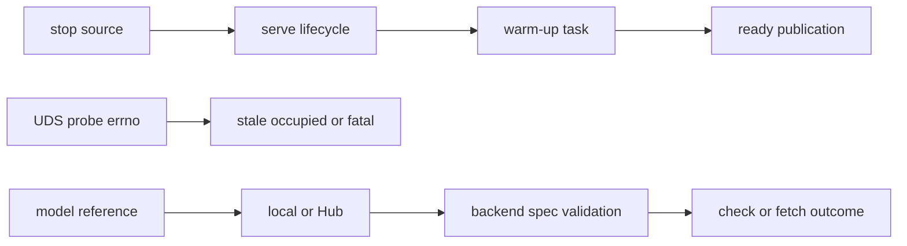
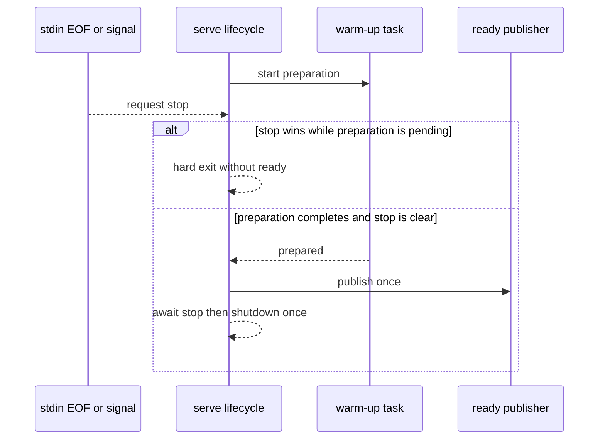

# Bug: PR #14 review findings

**Status:** In Progress
**Component:** Server Runtime
**Assigned to:** Codex
**Priority:** High
**Branch:** `fix/pr14-review-findings`
**Created:** 2026-10-24
**Review Gates:** none

## Objective

Resolve the three PR #14 review findings without weakening the UDS trust boundary or changing unrelated runtime behaviour: supervised shutdown during warm-up, conservative Unix-socket occupancy detection, and honest local-model prefetch results.

## Context

PR #14 adds supervised serving, prefetch support, and the Kyutai backend. Review found three false-success or delayed-exit paths at those integration seams. The branch is based on `main` at `2707c68`; the reviewed branch began this fix at `3fdce6a`.

## Requirements

- Race supervised stop against both server startup and readiness preparation. Split warm-up from the irreversible `ready` publication, make stop dominant before publication, and move the cleanup boundary above both races. If a non-cancellable worker is still running when stop wins, exit promptly without emitting `ready`; that hard exit is the only cleanup bypass, while normal and cancellable paths shut down exactly once through `finally`.
- Treat only `ECONNREFUSED` or `ENOENT` from a UDS connect probe as proof that a socket is stale. Timeout, `EAGAIN`, permission failures, and unknown errors are occupied/fatal and must not permit replacement.
- Existing PR #13 socket-directory and peer-credential trust checks remain unchanged.
- Strings beginning with `/`, `./`, `../`, or `~` are explicit local references; existing bare relative paths remain local, while other strings remain Hub repository IDs. Local references must be directories and satisfy the selected backend's `SnapshotSpec.required` patterns. Those patterns prove structural prefetch completeness, not every third-party loader semantic. Kyutai local paths are explicitly unsupported. Check mode reports `cached: false`; fetch mode emits an error.
- Add focused regressions, run formatting/lint, and pass the full suite. Do not stage, commit, push, or change branches.

## Review Focus

- Stop must win at every pre-ready await without a late ready event or a cancellability hang.
- UDS preflight must preserve the original live socket inode for ambiguous probe failures.
- Local completeness must reuse backend `SnapshotSpec.required` patterns rather than duplicate a divergent file list.

## Implementation Checklist

### Phase 1: Supervised readiness cancellation

**Impl files:** `stt_server/server.py`
**Test files:** `tests/test_supervised_cli.py`
**Test command:** `uv run pytest tests/test_supervised_cli.py -q`
**Goal:** A stop observed before readiness completes prevents `ready` and cannot wait on a non-cancellable model worker.

- Race the ready callback against the existing stop future.
- Start with a failing blocked-warm-up regression and record its red state.
- Split asynchronous warm-up preparation from synchronous ready-event publication; check stop before publication.
- Preserve prompt hard-exit behaviour when stop wins while the awaited work remains pending.
- Move the cleanup boundary above the races and prove normal shutdown runs exactly once.

### Phase 2: Conservative UDS preflight

**Impl files:** `stt_server/__main__.py`
**Test files:** `tests/test_supervised_cli.py`
**Test command:** `uv run pytest tests/test_supervised_cli.py -q`
**Goal:** Only narrowly proven stale sockets may reach replacement; all ambiguous probe errors preserve the inode and fail closed.

- Classify probe errors by errno.
- Start with failing timeout and `EAGAIN` inode-preservation regressions.
- Cover the complete classifier: `ECONNREFUSED`/`ENOENT` permit stale replacement; timeout/`EAGAIN` report occupied; `EACCES`/`EPERM` and an unknown errno remain fatal. Every occupied/fatal branch preserves the inode.

### Phase 3: Local-model prefetch validation

**Impl files:** `stt_server/prefetch.py`
**Test files:** `tests/test_prefetch_cli.py`
**Test command:** `uv run pytest tests/test_prefetch_cli.py -q`
**Goal:** Missing or incomplete local model paths never produce cached/complete success.

- Start with failing missing and incomplete path regressions in check and fetch modes.
- Classify the model reference and derive its backend spec before branching into mode-specific outcomes.
- Validate local directories with the backend's required snapshot patterns.
- Cover missing, incomplete, and complete supported paths in both modes, including Kyutai rejection and a sentinel required-pattern assertion.

### Phase 4: Verification and documentation

**Impl files:** `docs/dev_plans/20261024-bug-pr14-review-findings.md, docs/dev_plans/README.md`
**Test files:** `tests/test_supervised_cli.py, tests/test_prefetch_cli.py`
**Test command:** `uv run pytest -q`
**Validation cmd:** `uv run ruff format --check . && uv run ruff check .`

- Sweep the touched files for the same three mechanisms.
- Record focused and full-suite results.

## Technical Specifications

### Files to Modify

- `stt_server/server.py` — extend the supervised stop race through readiness.
- `stt_server/__main__.py` — narrow stale-socket classification.
- `stt_server/prefetch.py` — validate local model paths and required files.
- `tests/test_supervised_cli.py` — readiness-stop and UDS probe regressions.
- `tests/test_prefetch_cli.py` — local path check/fetch regressions.
- `docs/dev_plans/20261024-bug-pr14-review-findings.md` and `docs/dev_plans/README.md` — decision record and status index.

### New Files to Create

- No runtime or test modules; only this plan file.

### Architecture Decisions

- Reuse the existing hard-exit strategy only when stop wins against work that may be blocked in a non-cancellable worker.
- Map ambiguous UDS probe failures to `EADDRINUSE`, preserving the original errno only for permission/fatal failures where it is actionable.
- Represent a local model with the selected backend's `SnapshotSpec` so local and Hub structural completeness share `_complete()` without claiming a complete third-party loader contract.

### Dependencies

- No dependency changes. Current constraints include Python `>=3.12`, `websockets>=16,<17`, pytest `>=8`, and Ruff `>=0.8`.

### Integration Seams

| Seam | Writer | Caller | Contract |
|---|---|---|---|
| stop future | stdin watcher / signal handler | `serve()` lifecycle | Stop before ready prevents output and prompt exit is bounded. |
| UDS inode | existing listener | `_preflight_listener()` | Ambiguous probe failures never authorize unlink/rebind. |
| model requirement patterns | backend `prefetch_specs()` | local validation | The same required globs define Hub and local completeness. |

## Architecture & Call Flow

| Step | Trigger | Enters context | Cleared/persisted | Turn boundary |
|---|---|---|---|---|
| 1 | stdin EOF or SIGINT/SIGTERM | shared stop future | Persists through lifecycle | Stop future resolves |
| 2 | listener started | warm-up callback | Worker may outlive task cancellation | Warm-up completes or stop wins |
| 3 | warm-up complete and stop clear | listener/backend metadata | One JSON event is emitted | Ready published |
| 4 | UDS path exists | probe error and original inode | No mutation during preflight | Classified stale/occupied/fatal |
| 5 | prefetch model argument | lexical source type and backend spec | Check emits status; fetch emits completion/error | CLI returns |

## Testing Notes

### Test Approach

- [ ] Subprocess regression for EOF during blocked warm-up with a prompt-exit bound and no ready output; retain the existing blocked-startup coverage.
- [ ] Lifecycle regression for the normal/cancellable path with exactly one shutdown.
- [ ] Parameterized UDS regressions for stale, occupied, permission, and unknown errors with inode checks.
- [ ] CLI regressions for missing, incomplete, and complete local paths in check and fetch modes, Kyutai rejection, and sentinel-pattern reuse.
- [ ] Ruff and full pytest suite.

### Test Results

- [ ] Focused tests pass.
- [ ] Ruff format and lint pass.
- [ ] Full suite passes.

### Edge Cases Tested

- [ ] Stop arrives after bind but before warm-up completes.
- [ ] Probe timeout and full-backlog-style `EAGAIN` preserve the socket inode.
- [ ] Missing and incomplete local paths cannot become vacuous success.
- [ ] Kyutai local paths are rejected explicitly.

## Acceptance Criteria

- Each review finding has a regression test that fails on the pre-fix code and passes after the fix.
- The same-mechanism sweep finds no additional affected call sites in the touched files.
- PR #13 trust-boundary checks remain intact.
- Ruff and the full test suite pass.
- Worktree changes remain unstaged and uncommitted on `fix/pr14-review-findings`.

<!-- reviewed: 2026-10-24 @ c0c81648f0aabb87f533de8c8ddf914549959d28 -->

## Progress

- [x] Phase 1: Supervised readiness cancellation
- [x] Phase 2: Conservative UDS preflight
- [x] Phase 3: Local-model prefetch validation
- [x] Phase 4: Verification and documentation
- [x] Follow-up fixes after the PR #14 re-review (see below)

## Findings

- Explore found one supervised `ready` callback, one UDS listener preflight, and one local-model classification call site in the touched runtime files.
- Red-state regressions reproduced the readiness hang, broad UDS error acceptance, and vacuous local-model success before runtime changes.
- Focused post-fix gates: 9 supervised/readiness/preflight cases passed; all 26 prefetch tests passed; Ruff format and check passed.
- The background full suite reached 344 passed and 3 skipped, but the sandbox denied TCP and UDS binds with `EPERM`, causing 36 failures and 15 setup errors. No failure asserted changed behavior.

## Issues & Solutions

- The existing pytest launcher had a stale shebang. `uv sync --inexact` retained the environment; verification used `.venv/bin/python -m pytest` against the installed pytest 9.0.3.
- The sandbox and computer-use safety layer both prevent a socket-capable full-suite run in this session. Phase 4 remains open.

## Follow-up fixes (after the original three findings)

Recorded here, below the review marker, so the reviewed plan above stays signed
off. Each landed with a regression test that fails on the pre-fix code.

- **Hard-exit cleanup.** A stop during startup/warm-up that exits via
  `os._exit` first runs `TranscriptionServer.abort_sync()`: it unlinks the Unix
  socket only if it is still the inode this process bound, and calls the
  backend's optional `abort()` hook (parakeet/nemotron private temp dir). The
  single-server lock is NOT released there; the kernel drops it at exit, so a new
  server cannot start loading while the old process still exists.
- **Hard exit is opt-in.** `serve(..., hard_exit_on_stop=False)` is the library
  default: a stop during startup/warm-up cancels the pending step (bounded wait)
  and runs the normal `shutdown()`. `python -m stt_server serve` (plain and
  `--supervised`) passes `True`, keeping the prompt exit for the process owner.
- **Prefetch progress.** `total_bytes`/`files_total` count only files not yet
  cached, `downloaded_bytes` includes partial `.incomplete` blobs, and a final
  progress event reaches the total before `done`.
- **Kyutai config-named weights.** Prefetch and the loader take `mimi_name`,
  `moshi_name` and `tokenizer_name` from the repo's `config.json` (one
  `weight_files()` shared by both), and each name must be a plain filename: no
  `/`, `..` or glob characters, since it is used as an `allow_patterns`/`fnmatch`
  pattern.
- **Error classification.** A bare `ConnectionError`/`TimeoutError` is a
  `ModelDownloadError` only when tagged by `snapshot.download_phase()`, which
  wraps a backend's fetch-and-load call and prefetch's Hub calls, never a
  decode (warm-up is no longer tagged wholesale). A prefetch failure where the
  snapshot itself is unusable (incomplete, corrupt or incomplete `config.json`,
  incomplete local directory) is the new `ModelInvalidError`; existing codes are
  unchanged. `_run_serve` chains its `SystemExit` with an explicit `from exc`.
- **`DecodeGuardMixin`.** One decode-lock pair, in-flight counter and bounded
  `close()` drain for all four MLX backends; `_run_guarded_decode` undoes the
  in-flight mark if the decode thread fails to start.
- **Single-server flock on `<socket>.lock`.** Taken before the model load; the
  supervised preflight treats a held lock as a live server (a full backlog no
  longer passes as stale). A pre-existing owned lock file with group/other bits
  is tightened to `0600`, a foreign one refused; the preflight probe uses a
  shared lock and a starter retries a contended lock for 250 ms, so a probe never
  makes a concurrent real start fail.
- **Lifecycle.** A failed `start()` runs the backend `abort()` hook (no temp-dir
  leak per failed start); `shutdown()` is bounded even if a task swallows
  cancellation (drain timeout + 2 s cancel grace, `wait_closed` bounded too) and
  releases the lock in a `finally`.
- **Structure.** `backends.BACKENDS` is the single registry for CLI choices,
  `--model` defaults, construction and prefetch modules; `SnapshotSpec` moved to
  the stdlib-only `stt_server.snapshot` (re-exported by `prefetch`); the optional
  `abort()` hook and `prefetch_specs()` are documented in `backend.py`.

Deferred (design scope, not fixed here): pinning Kyutai (or any backend) to a
Hub revision, and a CI job that loads a real Kyutai model.

## Final Results

- All findings above resolved on `fix/pr14-review-findings`; Ruff format/check
  clean; full suite green except the pre-existing, unrelated
  `tests/test_justfile_recipes.py::test_stt_list_prints_socket_in_tilde_form`.
